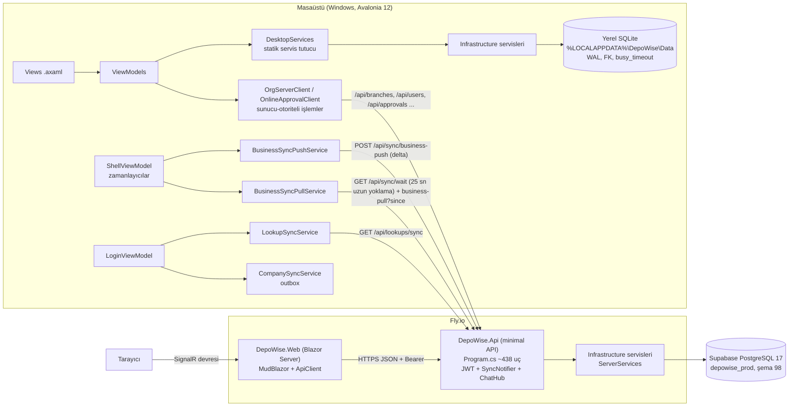

# 02 — Mevcut mimari ve modül haritası (A2a)

> Tarih: 2026-10-13 · Dal: `arge/2026-10-kapsamli` · Yöntem: yalnız okuma (kod + belge). Canlı sisteme, üretim
> DB'sine, derleme/test betiklerine dokunulmadı. Satır sayıları `wc -l` ile, `bin/obj` hariç ölçüldü.
> Doğrulanamayan çıkarımlar **(doğrulanmadı)** diye işaretlidir. Bağlayıcı mimari kaynak yine kök `CLAUDE.md` §2 +
> `docs/DECISIONS.md` (ADR); bu belge onları tekrar etmez, kodda ne bulunduğunu haritalar.

---

## 1. Çözüm (solution) ve proje yapısı

`DepoWise.sln` 7 proje içerir (Domain, Application, Infrastructure, Desktop, Api, Web, Setup) + `tests/DepoWise.Tests`.
`tests/DepoWise.Desktop.UiTests` **sln'de yok** (ayrı betikle koşar: `scripts/run_ui_tests.ps1`).

| Proje | Amaç | Ana klasörler | Dosya / satır (yaklaşık) |
|---|---|---|---|
| `src/DepoWise.Domain` | Teorik "çekirdek alan" (domain) katmanı | `Common/Entity.cs` | 1 .cs / 13 satır — **fiilen boş** |
| `src/DepoWise.Application` | Ortak sözleşmeler (contract), yetki kataloğu, ekran kataloğu, UI seçenek listeleri, rapor modelleri | `Security/` (AppScreens, AppModules, AccessControl, BranchAccess, FieldAccess…), `Ui/`, `Reports/`, `Common/`, `Sync/`, `Setup/`, `Update/` | 85 .cs / ~8.050 |
| `src/DepoWise.Infrastructure` | **Tüm iş kuralları** + veri erişimi (Dapper/ADO.NET), migration, rapor, Excel/PDF, senkron motoru | `Database/` (+98 migration), `Materials/`, `Vehicles/`, `Maintenance/`, `Operations/`, `Accounting/`, `Requests/`, `Reporting/`, `Security/`, `Sync/`, `Org/` + `Organization/`, `Files/`, `Update/` … | 219 .cs / ~44.000 |
| `src/DepoWise.Desktop` | Avalonia 12 masaüstü (MVVM, CommunityToolkit.Mvvm), yerel SQLite, senkron istemcileri | `ViewModels/` (~80), `Views/` (~65 axaml), kök: senkron/güncelleme/ses/yazdırma servisleri | 215 .cs / ~34.000 + 77 .axaml / ~15.600 |
| `src/DepoWise.Api` | ASP.NET Core minimal API (`/api/...`), JWT, SignalR sohbet hub'ı | `Program.cs` (tek dosya, tüm uçlar), `ServerServices.cs`, `Stores/`, `SyncNotifier.cs` | 11 .cs / ~6.660 (bunun 5.555'i `Program.cs`) |
| `src/DepoWise.Web` | Blazor Server + MudBlazor 9.6 web arayüzü; **iş kuralı taşımaz**, API'yi çağırır | `Components/Pages/` (~68 sayfa), `Components/` (ortak diyaloglar), `Services/ApiClient.cs` | 94 .razor / ~27.900 + 11 .cs / ~1.560 |
| `src/DepoWise.Setup` | Avalonia kurulum aracı (Setup.exe) | `SetupRunner.cs`, `Views/` | 4 .cs + 4 .axaml / ~900 |
| `tests/DepoWise.Tests` | xUnit 2.5 — servis, API (`ApiTestHost`, WebApplicationFactory), PG, kaynak-metin taramalı UI sözleşme testleri | düz klasör, 381 .cs | ~87.600 |
| `tests/DepoWise.Desktop.UiTests` | xUnit v3 + Avalonia.Headless (Skia ekran görüntüsü) | 5 .cs | ~900 |
| `tests/web-e2e` | Playwright (JS), canlıda salt-okuma duman testleri | `tests/*.spec.js` (4 spec) | — |

### Projeler arası bağımlılık

```
Domain  <──  Application  <──  Infrastructure  <──  Api
   ^             ^   ^               ^
   |             |   └───────────────┴──────────  Desktop (Domain+Application+Infrastructure referansı)
   |             |
   |   (proje referansı YOK, yalnız "Compile Include" ile 17 dosya bağlı) ──  Web
   |   (proje referansı YOK, 6 Setup/*.cs dosyası bağlı)                   ──  Setup
Tests ──> Api, Infrastructure, Application, Domain   (Desktop/Web'e referans YOK)
UiTests ──> Desktop
```

Kanıt: `src/*/*.csproj`. Önemli sonuç: **Masaüstü, sunucuyla AYNI `Infrastructure` servislerini kendi yerel SQLite'ı
üzerinde çalıştırır** (`DesktopServices.cs` ~70 servis örneği, DI konteyneri yok, statik özellikler). API aynı
servisleri `ServerServices.cs`'te PostgreSQL üzerinde kurar. Web ise bu katmanı hiç görmez; yalnız HTTP/JSON konuşur.

### "Ortak dosya — Compile Include" tuzağı
- `src/DepoWise.Web/DepoWise.Web.csproj` Application'daki 17 dosyayı bağlantı (link) olarak derler: `Ui/ListColumns.cs`,
  `Common/Meter.cs`, `Requests/RequestOperationStatus.cs`, `Ui/MovementTypeOptions.cs`, `Security/AppScreens.cs`,
  `Security/MenuIcons.cs`, `MenuPalette.cs`, `MenuLayout.cs`, `FieldProtectionCatalog.cs`, `Common/BaglantiIzleyici.cs`,
  `Ui/UserPrefKeys.cs`, `Ui/DailyActivityTypeOptions.cs`, `Ui/ReportSortOptions.cs`, `Ui/MeterUnitOptions.cs`,
  `Common/FuelMath.cs`, `Notifications/BildirimSesi.cs`.
- Tuzak: bu dosyalar **başka Application tiplerine bağımlı olamaz** (web'de yoklar → web derlemesi kırılır). Yeni ortak
  tip ya bağlı bir dosyaya eklenir ya da csproj'a yeni satır eklenir (CLAUDE.md §2).
- Aynı ihtiyaç bazı yerlerde **el ile kopya** ile çözülmüş: `src/DepoWise.Web/Services/VehicleStatus.cs` kendi
  yorumunda "`Application/Ui/VehicleStatus.cs`'in AYNASIDIR, ikisi BİRLİKTE güncellenmelidir" der (satır 10–11).
  `BranchGuard` da hem `Desktop/BranchGuard.cs` hem `Web/Services/BranchGuard.cs` olarak iki kez var.
- Belge kayması: `.claude/rules/list-screens.md` "`Web/Services/ListColumns.cs` AYNASI, ikisi birlikte" der; gerçekte
  web'de fiziksel dosya yok, bağlantı (link) var — kural metni eskimiş.

---

## 2. Çalışma zamanı (runtime) mimarisi

### 2.1 Veri akışı şeması



### 2.2 Masaüstü
- Giriş: `Program.cs` → `App.axaml.cs` → `DesktopBootstrap.cs` (yerel DB + `MigrationRunner`) → `LoginWindow`/`LoginViewModel`
  (830 satır) → `MainWindow` + `ShellViewModel` (2.014 satır; menü, gezinme `Navigate` içinde 68 `case`, zamanlayıcılar,
  günlük yedek, güncelleme kontrolü, uyarılar).
- Servis erişimi: `DesktopServices.cs` (281 satır) — "DI container yok" (satır 24–26), tüm VM'ler statik özelliklerden alır.
- Yerel DB: SQLite, `SqliteConnectionFactory.cs`; aynı migration kataloğu yerelde de koşar.
- **Senkron bileşenleri** (hepsi `src/DepoWise.Desktop/` kökünde):
  - `CompanySyncService.cs` — firma kayıtları için çevrimdışı **outbox** kuyruğu (FIFO, idempotent sunucu).
  - `LookupSyncService.cs` — girişte tanımlar, şubeler, ekipler, hiyerarşi aynası (`/api/lookups/sync`, sunucu-otoriteli,
    replace). Girişte kullanıcı adı/şifreyle **ikinci kez** `/api/auth/login` çağırır (`LoginViewModel.cs:492`).
  - `BusinessSyncPushService.cs` — yerel değişiklikleri makineye özgü **watermark**'tan (`updated_at > wm`) sonra delta
    snapshot olarak `POST /api/sync/business-push`'a yollar; 300 sn zaman aşımı; sonuç `{upserted, skipped, permanentSkipped}`.
  - `BusinessSyncPullService.cs` — `GET /api/sync/business-pull?since=` ile delta çeker, yerele LWW uygular; bakiye
    `ApplyPull` sonunda defterden yeniden hesaplanır.
  - Anlık eşitleme: `GET /api/sync/wait?since=` (sunucu en fazla 25 sn bekler, `Program.cs:524–540`); giden için 3 sn'de
    bir yerel kontrol (`ShellViewModel.cs:592` `YerelKontrolSaniye=3`), 30 sn güvenlik zamanlayıcısı (`FastTickSeconds=30`,
    satır 670) ve CURRENT_PHASE'e göre 60 sn güvenlik ağı turu.
  - `SyncGate.cs`, `SyncLog.cs`, `BranchMirror.cs`, `MachineGate.cs` (makine kaydı/kotası), `LocalPurgeService`/`LocalResetService`/
    `MachineResetLocalService` (sunucudan gelen sıfırlama komutları).
- Sunucu-otoriteli (yalnız çevrimiçi) işlemler: şube + kullanıcı (`OrgServerClient.cs` başlık yorumu), onaylar
  (`OnlineApprovalClient.cs:10–33`), ekipler, evrak/proje (`DesktopServices.cs:116–119`), sohbet (SignalR istemcisi).

### 2.3 Web
- `src/DepoWise.Web/Program.cs`: Blazor Server; `DisconnectedCircuitRetentionPeriod=1 dk`, `MaxRetained=20` (satır 29–30,
  256 MB makine için); her devreye `AuthState`, `HttpClient(30 sn)`, `ApiClient`, `ThemeState`, `WebSesServisi` (scoped).
- `Services/ApiClient.cs` (844 satır): tipli birkaç giriş metodu + **tipsiz genel yardımcılar** (`GetArrayAsync`,
  `GetObjectAsync`, `PostAsync`, `OptionsAsync`…). Sayfalar URL'yi metin olarak verir; bileşenlerde ~595 `api/...` dize sabiti
  var; en çok kullanılanlar `OptionsAsync` 140, `PostAsync` 120, `GetArrayAsync` 103 kez.
- Yerleşim: `Layout/MainLayout.razor` (881 satır; rota koruması, `WebSayfaAnahtari` ile `@key`), `NavMenu.razor`
  (sözde yetki anahtarları `@admin/@super/@superr`, satır 79), `ChatDock.razor`.

### 2.4 API
- Tek dosya `src/DepoWise.Api/Program.cs` (5.555 satır, ~370 KB): **438 `Map*` çağrısı, `MapGroup` hiç yok**. Uç
  önekleri (adet): vehicles 25, stock 19, materials 16, maintenance 14, finance 14, work-orders 13, sync 13, users 12,
  fuel 11, requests/personnel/parties/me/invoices/daily 10'ar, machines 9 … toplam ~75 önek.
- Ara katmanlar (middleware) sırası (`Program.cs:96–200`): güvenlik başlıkları → gzip sıkıştırma → CORS (`AllowAnyOrigin`) →
  JWT kimlik doğrulama → istek sayacı/çevrimiçi izleme → **yazma sonrası `SyncNotifier.Notify(company)`** → erişim logu →
  hata eşleme (`ForbiddenException`→403, `ConcurrencyException`→409, `NegativeStockException`/`MeterBackwardException`/
  `ArgumentException`/`InvalidOperationException`→400, diğer→500 + `{"error":...}`).
- Kimlik: `JwtTokens.cs` (sub + company claim), `DEPOWISE_JWT_KEY` üretimde zorunlu (`Program.cs:28–40`); SignalR için
  jeton yalnız hub yolunda sorgu dizesinden kabul edilir. Her uçta `S(c)`/`Session(ctx)` JWT'den `SessionContext`'i sunucuda
  yeniden kurar (`ServerServices.SessionFor`) → firma (tenant) yalnız oturumdan gelir.
- Hız sınırları (bellek içi `RateLimiter`): giriş 30/5 dk/IP, anonim liste 120/dk, makine kaydı 30/5 dk, indirme 30/10 dk,
  yedek yükleme 60/saat.
- `ServerServices.cs` (334 satır): `DEPOWISE_PG_URL` varsa `PostgresConnectionFactory`, yoksa SQLite; açılışta
  `new MigrationRunner(Factory).Run()` (satır 149–153); ~75 servis tekil (singleton) olarak kurulur.
- `SyncNotifier.cs`: firma başına bellek içi `TaskCompletionSource`; **tek makine varsayımı** (yorum satır 12).
- Eski cihaz-jetonlu operasyon senkronu `/sync/push` + `/sync/pull` (`Program.cs:466–478`, `Infrastructure/Sync/SyncServer.cs`:
  operation_id idempotency + base_version çakışması) hâlâ yayında; ancak `src/` içinde **istemcisi bulunamadı** (yalnız
  testler) — masaüstü iş verisini snapshot/delta yoluyla taşır.

### 2.5 Veritabanı
- `Infrastructure/Database/Migrations/`: `Migration001_CoreSchema` … `Migration098_RentalVehicles` (`Version => 98`),
  `MigrationCatalog.cs`, `MigrationRunner.cs` (sürüm tablosu; uygulanmamış olanları sırayla koşar).
- İki lehçe (dialect): `SqlDialect.cs` (171 satır, `internal`), `DbIntrospect.cs` (143, `ColumnExists` ile eski şemaya
  dayanıklılık), `DialectPurge.cs`, `SqliteToPgCopier.cs`. Lehçe dalı en çok `FuelService` (10), `StockService` (8),
  `ReportService` (7), `MaintenanceService` (7) içinde.
- Diğer altyapı: `TenantSql.cs` (firma filtresi yardımcısı), `GridQuery.cs` (liste filtre/sıralama/sayfalama),
  `EditLockGuard.cs` (düzenleme kilidi → 409), `AuditWriter.cs`/`AuditSnapshot.cs`/`AuditLogService.cs`, `BranchRepository.cs`.
- Para/miktar metin olarak saklanan `decimal`, zaman UTC ms (CLAUDE.md §3; `Application/Common/Money.cs`, `Time.cs`,
  `IsGunuTarihi.cs`).

### 2.6 Infrastructure servis listesi (klasöre göre)
| Klasör | Servisler |
|---|---|
| Materials | MaterialService, LookupService, MaterialTemplateService, StockService (1.578 satır), StockBalanceWriter, OpeningStockService, StockChangeLogService, StockMovementFilterSql |
| Vehicles | VehicleService (1.051), VehicleTemplateService, VehicleMeterService |
| Maintenance | MaintenanceService, MaintenanceDefinitionService, InspectionService, EquipmentMaintenanceService, EquipmentInspectionService |
| Operations | FuelService, DailyActivityService, KullanilanMalzemeler |
| Requests | RequestService, RequestOperationsService, RequestPdfService |
| Accounting | PartyService, PartyLedgerService, InvoiceService (+InvoiceReads/InvoiceQueryService), FinanceService (+FinanceReads/FinanceQueryService), CostCenterService, AccountingFieldGate |
| Equipment / Assignments / Purchasing / WorkOrders / Calendars / Announcements / Teams / Chat / Search | EquipmentService, AssignmentService, PurchaseOrderService, WorkOrderService, CalendarService, AnnouncementService, TeamService, ChatService, SearchService |
| Approvals | ApprovalService, UserHierarchyService |
| Org | PersonnelService, PersonnelTitleService, ScopeResolver, (BranchService, CompanyService — bkz. §5) |
| Organization | BranchService, CompanyService, CompanyGrantService, RoleGrantService, CompanyPurgeService, CompanyLocalResetService, ScreenVisibilityService, FieldRequirementService, FieldProtectionService, MenuLayoutService, ProjectService, BranchTree, BranchMirrorApply, BusinessDataExtras |
| Security | AuthService, UserService, PermissionService (1.038), PermissionTemplateService, SpecialCodeService, PasswordHasher |
| Reporting | ReportService (2.789), AccountingReports, CustomReportService, DashboardService, FleetAlerts, ExcelExportService, ExcelCenterService, TablePdfService, QrLabelService, ReportScope, 7 içe aktarma servisi (Material/Vehicle/Personnel/Maintenance/Inspection/Fuel/FuelDepot) + ImportLookupResolver |
| Files | FileService, DocumentService, TrashService, BackupService, BackupUploadService, ImageOptimizer, LocalFileStorageProvider |
| Sync | BusinessSyncService (1.613), SyncServer, EnrollmentService, MachineResetService, OutboxWriter, SyncCrypto |
| Update / Settings | ReleaseService, UpdateService, UpdateDownloadService, UpdateApiClient · SettingsService, UserListPreferenceService |

---

## 3. Modül haritası

Ekran kataloğu: `src/DepoWise.Application/Security/AppScreens.cs` — **73 ekran** (`All`, satır 140–319), 25 menü grubu,
6 üst bölüm (section). Platform: 60 ekran iki ortamda, 2 yalnız masaüstü (`material_templates`, `stock.distribute`; ayrıca
`import_export` masaüstü eşi), 11 yalnız web (yönetim ekranları). Masaüstü 62, web 71 ekran gösterir.

Senkron sütunu açıklaması: **İki yön** = `BusinessSyncService.Tables` (push+pull, LWW `updated_at`); **defter** = append-only
tablo, `operation_id` tekil indeksi + sunucuda yeniden hesap; **ayna** = sunucu-otoriteli, girişte iner, masaüstü yazmaz;
**çevrimiçi** = yerel kopya yok, doğrudan API; **yok** = senkron dışı.

| Modül (yetki anahtarı) | Masaüstü VM / View | Web sayfası | API önekleri | Infrastructure servisi | Ana tablolar | Senkron |
|---|---|---|---|---|---|---|
| Uyarılar (`alerts`) | AlertsViewModel / AlertsView, `AlertFeed.cs` | Alerts.razor | /api/alerts, /api/dashboard | DashboardService, FleetAlerts, `Application/Maintenance/AlertRules.cs` | alert_reads (+türetilmiş) | türetilmiş; alert_reads çevrimiçi |
| Malzemeler (`materials`) | MaterialsViewModel (1.097) / MaterialsView (854), MaterialQuickEditWindow | Materials.razor (1.098), MaterialEditDialog | /api/materials, /api/lookups, /api/lookup-plus | MaterialService, LookupService | materials, material_equivalents, material_compatible_vehicles, units, brands, suppliers, material_categories | İki yön (LWW, çakışma izlenir) |
| Malzeme şablonları (`material_templates`) | MaterialTemplatesViewModel / View (yalnız masaüstü) | — | /api/material-templates | MaterialTemplateService | material_templates | İki yön |
| Stok Giriş-Çıkış / Hareketler / Sayım / Dağıtım (`stock`) | StockEntryViewModel (961), StockMovementsViewModel, StockCountViewModel, StockDistributeViewModel (yalnız masaüstü) | Stock.razor, StockMovements.razor, StockCount.razor, StockDistribute.razor | /api/stock | StockService, StockBalanceWriter, OpeningStockService | stock_movements (defter), stock_documents, stock_count_lines, stock_balances (türetilmiş) | Defter: hareketler iki yön, bakiye taşınmaz, sunucu `RecomputeBalances` (`Program.cs:497`) |
| Araçlar / Kiralık (`vehicles`) | VehiclesViewModel (1.141) / VehiclesView (1.009), VehicleQuickEditWindow | Vehicles.razor (1.055), VehicleEditDialog | /api/vehicles | VehicleService, VehicleMeterService | vehicles (+kira sütunları M098), vehicle_meter_logs, vehicle_types/categories/models | İki yön (LWW, çakışma izlenir); sayaç logu append-only |
| Araç şablonları (`vehicle_templates`) | VehicleTemplatesViewModel / View | VehicleTemplates.razor | /api/vehicle-templates, /api/templates | VehicleTemplateService | vehicle_templates, vehicle_template_materials | İki yön |
| Muayene/Sigorta (`inspection`) | InspectionViewModel / View | Inspection.razor | /api/inspection, /api/equipment-inspection | InspectionService, EquipmentInspectionService | vehicle_inspections, equipment_inspections | İki yön |
| Günlük Faaliyet (`daily_activity`) | DailyActivityViewModel (825) / View | Daily.razor (745) | /api/daily | DailyActivityService | daily_activities | İki yön |
| Bakım (`maintenance`) | MaintenanceViewModel (1.080) / View | Maintenance.razor (1.111) | /api/maintenance, /api/equipment-maintenance | MaintenanceService, MaintenanceDefinitionService, EquipmentMaintenanceService | maintenance_definitions(+_vehicles/_equipment), vehicle_maintenances, maintenance_materials, equipment_maintenances(+_materials) | İki yön (vehicle_maintenances çakışma izlenir) |
| Yakıt (`fuel`) | FuelViewModel (696) / FuelView (668) | Fuel.razor (726) | /api/fuel | FuelService, `Application/Common/FuelMath.cs` | fuel_depot_entries, fuel_distributions | İki yön; negatif değer reddi |
| Talepler (`requests`, `request_approval`, `request_ops`) | RequestsViewModel, RequestOperationsViewModel, ApprovalsViewModel | Requests.razor, RequestOperations.razor, Approvals.razor | /api/requests, /api/request-ops, /api/approvals, /api/hierarchy | RequestService, RequestOperationsService, RequestPdfService, ApprovalService, UserHierarchyService | material_requests, material_request_items, request_status_history; approval_instance/approval_step/user_hierarchy | Talep: iki yön (çakışma izlenir); onay zinciri **yalnız çevrimiçi** (ayna) |
| Ön muhasebe: Cari (`parties`) | PartiesViewModel / View | Parties.razor | /api/parties | PartyService, PartyLedgerService | parties, party_ledger | İki yön; party_ledger şube kapsamlı, operation_id |
| Fatura (`invoices`) | InvoicesViewModel, InvoiceLineEditor | Invoices.razor | /api/invoices | InvoiceService, InvoiceQueryService | invoices, invoice_lines, invoice_series, vat_rates | İki yön; operation_id tekil |
| Kasa/Banka, Tahsilat (`finance`) | FinanceViewModel, PaymentsViewModel | Finance.razor, Payments.razor | /api/finance | FinanceService, FinanceQueryService | finance_accounts, finance_transactions, invoice_allocations | İki yön; operation_id tekil |
| Maliyet merkezi (`cost_centers`) | CostCentersViewModel | CostCenters.razor | /api/cost-centers | CostCenterService | cost_centers, cost_center_links | İki yön |
| Ekipman (`equipment`) | EquipmentViewModel | Equipment.razor | /api/equipment | EquipmentService | equipment, equipment_types | İki yön |
| Zimmet (`assignments`) | AssignmentsViewModel | Assignments.razor | /api/assignments | AssignmentService | assignment_movements | Defter (append-only, operation_id) |
| Satın alma (`purchasing`) | PurchasingViewModel | Purchasing.razor | /api/purchasing | PurchaseOrderService | purchase_orders, purchase_order_lines | İki yön |
| İş emirleri (`work_orders`) | WorkOrdersViewModel | WorkOrders.razor | /api/work-orders | WorkOrderService | work_orders, work_order_assignments/_links/_status_history | İki yön |
| Takvim (`calendar`) | CalendarViewModel | Calendar.razor | /api/calendar | CalendarService | calendar_events (türetilmiş öğeler senkronlanmaz) | İki yön |
| Duyurular (`announcements`) | AnnouncementsViewModel | Announcements.razor | /api/announcements | AnnouncementService | announcements | İki yön |
| Evrak (`files`) | DocumentsViewModel | Documents.razor | /api/documents, /api/photos | DocumentService, FileService | file_records (+M074/M089 alanları) | **Çevrimiçi** (sunucu-otoriteli); fotoğraflar 30 dk'da bir önbelleğe iner |
| Şube / Projeler (`branches`) | BranchesViewModel, ProjectsViewModel | Branches.razor, Projects.razor | /api/branches, /api/projects, /api/branch-scope | Organization.BranchService, ProjectService, BranchTree | branches, projects, project_branches | Şube: **ayna** + çevrimiçi yazma (`OrgServerClient`); projeler çevrimiçi |
| Personel (`personnel`) | PersonnelViewModel | Personnel.razor, PersonnelTitleEditor | /api/personnel, /api/personnel-titles | Org.PersonnelService, PersonnelTitleService | personnel, personnel_titles | İki yön (şube kapsamlı, çakışma izlenir) |
| Kullanıcı / Ekip / Yetki / Şablon (`users`, `permissions`, `permission_templates`) | UsersViewModel, TeamsViewModel, PermissionsViewModel (1.010), PermissionTemplatesViewModel | Users.razor, Teams.razor, Permissions.razor (941), PermissionTemplates.razor | /api/users, /api/teams, /api/permissions, /api/permission-templates, /api/roles, /api/role-permissions, /api/buttons, /api/modules, /api/me | UserService, TeamService, PermissionService, PermissionTemplateService, RoleGrantService | users, user_permissions, user_button_permissions, role_permissions, role_button_permissions, permission_templates, teams, team_members, user_scopes | Kullanıcı: çevrimiçi; ekip: ayna; yetki fotoğrafı yerelde önbellek |
| Raporlar / Tasarımcı (`reports`) | ReportsViewModel (842), CustomReportsViewModel | Reports.razor (938), CustomReports.razor | /api/reports, /api/custom-reports, /api/export | ReportService, AccountingReports, CustomReportService | (okuma) + custom_report_defs | Rapor yerelde koşar; custom_report_defs iki yön |
| Denetim (`audit`, `stock_change_log`, `sync_conflicts`) | AuditLogViewModel, StockChangeLogViewModel, SyncConflictsWindow | Audit.razor, StockChangeLog.razor, SyncConflicts.razor (yalnız web) | /api/audit, /api/sync/conflicts | AuditLogService, StockChangeLogService, BusinessSyncService | audit_logs, stock_change_logs, data_conflicts | audit/stock_change_log senkron listesinde **yok** (doğrulanmadı: sunucuya ayrı yoldan gidip gitmediği) |
| Web yönetimi (`companies`, `releases`, `machines`, `server_backups`, `machine_backups`, `quota_monitor`, `purge_company`, `local_reset`, `screen_visibility`…) | CompaniesViewModel, ReleasesViewModel, MachineManagementViewModel, ServerBackupsViewModel | Companies, Releases, Machines, ServerBackups, MachineBackups, ServerStatus, QuotaMonitor, CompanyPermissions, PurgeCompany, ResetCompanyBusiness, LocalReset, ScreenVisibility (.razor) | /api/companies, /api/releases, /api/machines, /api/backups, /api/machine-backups, /api/admin, /api/screens, /api/quota-monitor, /api/server, /api/company-permissions | CompanyService, ReleaseService, EnrollmentService, CompanyPurgeService, CompanyLocalResetService, ScreenVisibilityService, CompanyGrantService | companies, app_releases, sync_devices, company_grant_limits, company_purges, company_local_resets, machine_resets, screen_platform_visibility | Firma: outbox (CompanySyncService); diğerleri çevrimiçi |
| Yedekleme (`backup`) | (masaüstünden 2026-07-26'da kaldırıldı) BackupViewModel kalıntısı | Backup.razor | /api/backup, /api/backups | BackupService, BackupUploadService, `Api/Stores/BackupStore.cs`, `MachineBackupArchiver.cs` | dosya | Masaüstü günlük yedek yükler (`ShellViewModel.MaybeDailyBackupAsync`, satır 726) |
| Çöp kutusu (`trash`) | TrashViewModel | Trash.razor | /api/trash | TrashService | `is_deleted` bayraklı ~20 tablo (`TrashService.cs:18–31`) | silme bayrağı LWW ile taşınır; sunucuda silinen diriltilmez |
| Ayarlar: Tanımlar, Alan Ayarları, Excel Merkezi, Geliştirici, Tema, Hakkında, Güncelleme Notları | SettingsViewModel, FieldSettingsViewModel, ImportExportViewModel, DeveloperSettingsViewModel, ThemeSettingsViewModel, AboutViewModel, UpdateNotesViewModel | Definitions, FieldSettings, ImportExcel, Developer, Theme, Soon(about), UpdateNotes (.razor) | /api/settings, /api/field-requirements, /api/field-protections, /api/field-access, /api/import, /api/export | SettingsService, FieldRequirementService, FieldProtectionService, ExcelCenterService, 7 import servisi | app_settings, field_requirements, field_protections, user_list_preferences, menu_group_layout, screen_menu_layout | Tanımlar iki yön/ayna; alan kuralları ayna |
| Sohbet (`chat`, menüde ekran değil) | ChatViewModel | Layout/ChatDock.razor | /api/chat + SignalR `ChatHub` | ChatService | chat_messages | **Senkron dışı**, çevrimiçi |

---

## 4. Kesişen (cross-cutting) konular

| Konu | Nerede | Not |
|---|---|---|
| Yetki (permission) | `Application/Security/AccessControl.cs` (247), `AppModules.cs` (441, modül kataloğu + `IsExplicitOnly`), `PermissionSnapshot(.Cache).cs`, `Infrastructure/Security/PermissionService.cs` | Deny-by-default; servis metotları `SessionContext` alır ve `AccessControl.Require(...)` çağırır → masaüstü yerelde, API sunucuda aynı kapıdan geçer. Özel düğme yetkisi `RequireButton` (ör. `btn-conflict-resolve`). Web menüsünde geçiş dönemi sözde anahtarları `@admin/@super/@superr` (`NavMenu.razor:79`, `AppScreens.cs:39`). |
| Şube kapsamı | `BranchAccess.cs` (267), `BranchScope.cs`, `Org/ScopeResolver.cs`, `Desktop/BranchGuard.cs` + `Web/Services/BranchGuard.cs` | Senkronda da şube süzgeci: `BusinessSyncService.BranchScopedTables` (party_ledger, invoices, finance_*, vehicles, personnel, stock_movements, material_requests). Malzeme kartı bilinçli olarak firma geneli. |
| Alan düzeyi yetki | `FieldAccess.cs`, `FieldProtectionCatalog.cs` (web'e bağlı), `FieldProtectionService`, `AccountingFieldGate.cs`; rapor alan kapısı `ReportService.AlanKapisi` | Tutar raporları alan gizliyse tamamen kapatılır (fail-closed). |
| Denetim kaydı (audit) | `Database/AuditWriter.cs`, `AuditSnapshot.cs`, `Application/Common/AuditDiff.cs`, `AuditLogService.cs`, `ScreenAuditMap.cs` | 58 Infrastructure dosyası audit yazar; masaüstü `RecordHistoryWindow`/`HistoryDetailWindow`, web `AuditHistoryDialog`. |
| Çöp kutusu / yumuşak silme | `Files/TrashService.cs`, `DialectPurge.cs`, `CompanyPurgeService` | Operasyonel kayıt iptal/ters kayıtla kapanır; kalıcı silme yalnız süper admin web ekranı (ADR-083). |
| Onay pencereleri | `Desktop/ConfirmService.cs` (standart düzenle/sil/iptal metinleri tek yerde), web `Components/ConfirmDialog.razor` + `Services/DialogExtensions.cs` | Metinler iki ortamda ayrı dosyalarda tutuluyor. |
| Raporlar | `Application/Reports/ReportCatalog.cs` (467), `Infrastructure/Reporting/ReportService.cs` `DispatchIc` (satır 2749–2788) | **30 rapor anahtarı** (8 ön muhasebe + 22 operasyon). Tek switch, masaüstü (yerel) ve API aynı kodu koşar. Operasyon vs Yönetici raporu = şube kapsamı farkı. Rapor tasarımcısı: `CustomReportService` (440) + `CustomReportDefinition/Sources.cs`, tanımlar senkronlanır. |
| Excel | ClosedXML; `ExcelExportService`, `ExcelCenterService` (15 kaynak), 7 içe aktarma servisi | Liste ekranlarında "filtrelenmiş tüm sonuç" dışa aktarımı kuralı (`.claude/rules/list-screens.md`). |
| PDF / yazdırma | QuestPDF; `TablePdfService` (Excel ile aynı `TableModel`), `RequestPdfService`, `QrLabelService` (QRCoder); `Desktop/YazdirmaYardimcisi.cs` | |
| Güncelleme / yayın | Sunucu: `Update/ReleaseService.cs`, `Api/Stores/ReleaseStore.cs`, `/api/releases`, `/api/setup`; istemci: `AutoUpdateService.cs` (1 dk zamanlayıcı, `ShellViewModel.cs:948`), `UpdateInstaller.cs`, `UpdateService`/`UpdateDownloadService`; kurulum `DepoWise.Setup` + `Application/Setup/*` (paket doğrulayıcı, URL politikası) | Sözleşme `docs/UPDATE_CONTRACT.md`; yayın betiği `scripts/publish_release.mjs`. |
| Yedek | Masaüstü günlük yükleme (`BackupUploadService`), sunucu `BackupStore`/`MachineBackupArchiver`, betikler `scripts/yedek_al.ps1`, `yedek_prova.ps1` | |
| Bildirim / ses | `Application/Notifications/BildirimSesi.cs` (web'e bağlı), `Desktop/SesServisi.cs` (202), `Web/Services/WebSesServisi.cs` | |
| Güncelleme notları | `AppScreens.cs` içindeki `GuncellemeNotlari.Tumu` (satır 459+), `Desktop/GuncellemeNotuGosterici.cs`, web `GuncellemeNotuDialog.razor` | Tek kaynak; masaüstü yayın notu `MasaustuMetni(...)` ile aynı olmalı. |
| Düzenleme kilidi | `Database/EditLockGuard.cs` → `ConcurrencyException` → HTTP 409 | |

---

## 5. Gözlenen mimari riskler / teknik borçlar (kanıta dayalı, öneri değil)

1. **Tek dosyada API:** `src/DepoWise.Api/Program.cs` 5.555 satır, 438 uç, `MapGroup` yok. Uç başına yetki/oturum kalıbı
   (`S(c) is { } s ? ... : Results.Unauthorized()).RequireAuthorization()`) yüzlerce kez el ile tekrar ediliyor; birleşme
   çakışması ve gözden kaçan uç riski yüksek.
2. **Çok büyük dosyalar:** `ReportService.cs` 2.789 satır / 165 KB; `ShellViewModel.cs` 2.014 satır (gezinme + 5 zamanlayıcı +
   yedek + güncelleme + uyarı tek sınıfta); `BusinessSyncService.cs` 1.613; `StockService.cs` 1.578; `VehiclesView.axaml`
   93 KB, `MaterialsView.axaml` 78 KB, `MainWindow.axaml` 76 KB; web `Maintenance/Materials/Vehicles.razor` ~1.050–1.110 satır.
3. **Masaüstü–web UI mantığı ikiz:** Web Infrastructure'ı göremediği için her ekranın form/doğrulama/liste mantığı Razor'da
   yeniden yazılmış (ör. `MaterialsViewModel.cs` 1.097 ↔ `Materials.razor` 1.098; `MaintenanceViewModel.cs` 1.080 ↔
   `Maintenance.razor` 1.111). Eşitlik testlerle (`*ParityTests`, iki ortam denetçisi agent'ı) korunuyor, derleyiciyle değil.
4. **Tipsiz web–API sözleşmesi:** `ApiClient` çoğunlukla `JsonElement` döndüren genel metotlar; bileşenlerde ~595 `api/...`
   dize sabiti. API'de alan/rota adı değişirse web derlemesi bunu yakalamaz.
5. **Ortak kod üç farklı yöntemle paylaşılıyor:** proje referansı (Desktop/Api), `Compile Include` link (Web 17, Setup 6 dosya),
   el ile ayna (`Web/Services/VehicleStatus.cs:10–11`, iki `BranchGuard.cs`). Kural belgesi de kaymış
   (`.claude/rules/list-screens.md` web'de fiziksel `ListColumns.cs` aynası varsayıyor).
6. **Ölü/ikiz servis olasılığı:** `Infrastructure/Org/BranchService.cs` (125) ve `Org/CompanyService.cs` (72),
   `Organization/` altındaki aynı adlı servislerle yan yana. `src/` ve `tests/` içinde `Org.BranchService`/`Org.CompanyService`
   kullanımı bulunamadı (`IsEmriTests.cs:43` bile tam adla `Organization.BranchService` kullanıyor) → büyük olasılıkla
   kullanılmayan kod (doğrulanmadı: yansıma/dinamik kullanım aranmadı).
7. **Senkronun gerçek taşıma biçimi:** iş verisi genel "snapshot/delta + `updated_at` LWW upsert" ile taşınıyor
   (`BusinessSyncService.cs:9–17`). Stok/fatura/kasa/zimmet için koruma append-only defter + `operation_id` tekil indeksi +
   sunucuda bakiye yeniden hesabı. Operation-id tabanlı ayrı protokol (`/sync/push`, `SyncServer.cs`) yayında ama masaüstü
   istemcisi yok → iki senkron yolu bakım yükü. LWW, istemci saatine (`updated_at`) dayanır; saat kayması etkisi bu
   çalışmada ölçülmedi (A2'nin 07 numaralı raporuna bırakıldı). Çakışma izleme yalnız 5 tabloda (`ConflictTracked`,
   satır 1043–1046).
8. **Tek makine varsayımları:** `SyncNotifier` (bellek içi sinyal), `RateLimiter`, `ServerPresence`, `ServerMetrics` hepsi
   süreç belleğinde; API yatay ölçeklenirse anlık eşitleme ve hız sınırları bölünür (yorum `SyncNotifier.cs:12` bunu kabul ediyor).
9. **Her yazma tüm firmayı uyandırır:** `Program.cs:126–135` GET dışı her başarılı isteği (sohbet, tercih kaydı dahil)
   `SyncNotifier.Notify` ile yayınlar; bekleyen masaüstleri sürümü yeniden okur (DB sorgusu). Trafik etkisi ölçülmedi.
10. **Masaüstünde DI yok:** `DesktopServices` statik servis tutucu (~70 statik özellik); her senkron servisi kendi statik
    `HttpClient`'ını farklı zaman aşımıyla tutar (12 sn / 20 sn / 300 sn). Test edilebilirlik ve yeniden başlatma
    (firma değiştirme) durumunda durum sızıntısı riski (doğrulanmadı).
11. **Girişte çift kimlik doğrulama:** `LookupSyncService.PullAsync(username, password)` ham şifreyle ikinci bir
    `/api/auth/login` yapar (`LoginViewModel.cs:492`); giriş hız sınırına (30/5 dk/IP) iki kat yük ve şifrenin bellekte
    daha uzun tutulması.
12. **Domain katmanı boş:** `DepoWise.Domain` 13 satır; iş kuralları Infrastructure servislerinde SQL ile iç içe. Bu
    bilinçli bir tercih gibi görünüyor ama "Domain" adı yanıltıcı.
13. **Lehçe dalları iş servislerinde:** `SqlDialect` çağrıları `FuelService` (10), `StockService` (8), `ReportService` (7),
    `MaintenanceService` (7) içinde dağınık; SQLite ile PG davranış farkı (Türkçe harmanlama M053, tarih) her serviste ayrı ele alınıyor.
14. **CORS her kaynağa açık:** `Program.cs:66` `AllowAnyOrigin`. Çerez değil Bearer jeton kullanıldığı için doğrudan açık
    değil, ama gerekenden geniş.
15. **Testlerin çoğu kaynak-metin taraması:** `DepoWise.Tests` Desktop/Web'e referans vermez; 91 test dosyası
    `File.ReadAllText`, 80 dosya `.axaml/.razor/Desktop` metnine bakar → UI davranışı değil metin deseni doğrulanır
    (gerçek UI için yalnız 5 dosyalık Headless takımı + 4 Playwright spec).
16. **Belge kayması örneği:** `AppScreens.cs:316` "Hakkında" web rotası `soon/about` (yer tutucu `Soon.razor`); masaüstünde
    `BackupViewModel/BackupView` dosyaları duruyor ama ekran masaüstünden kaldırılmış (`AppScreens.cs` yedek yorumu).
